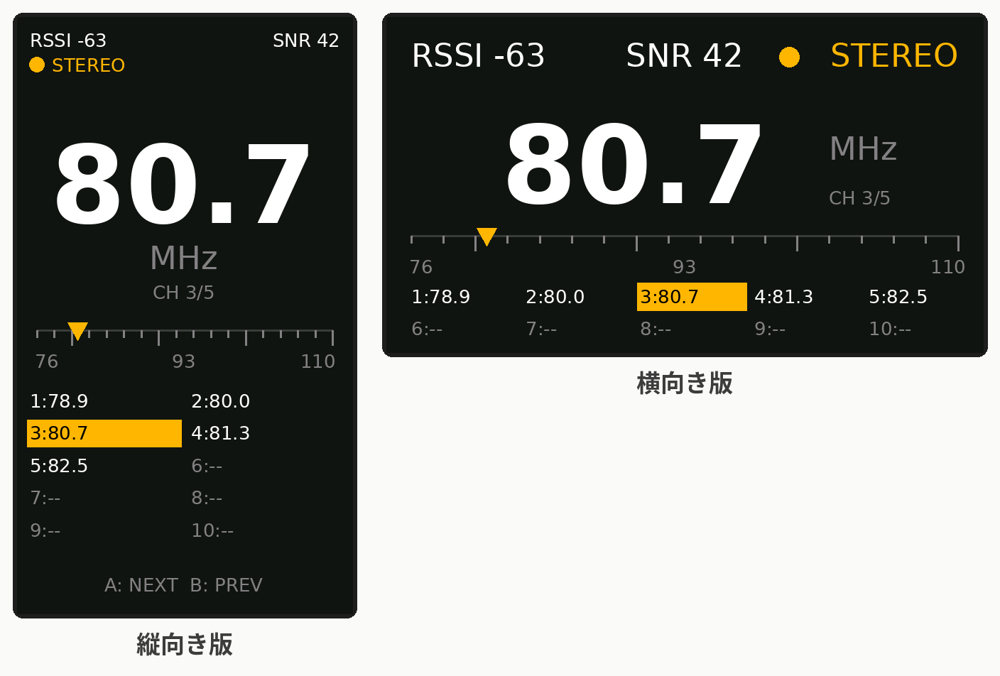
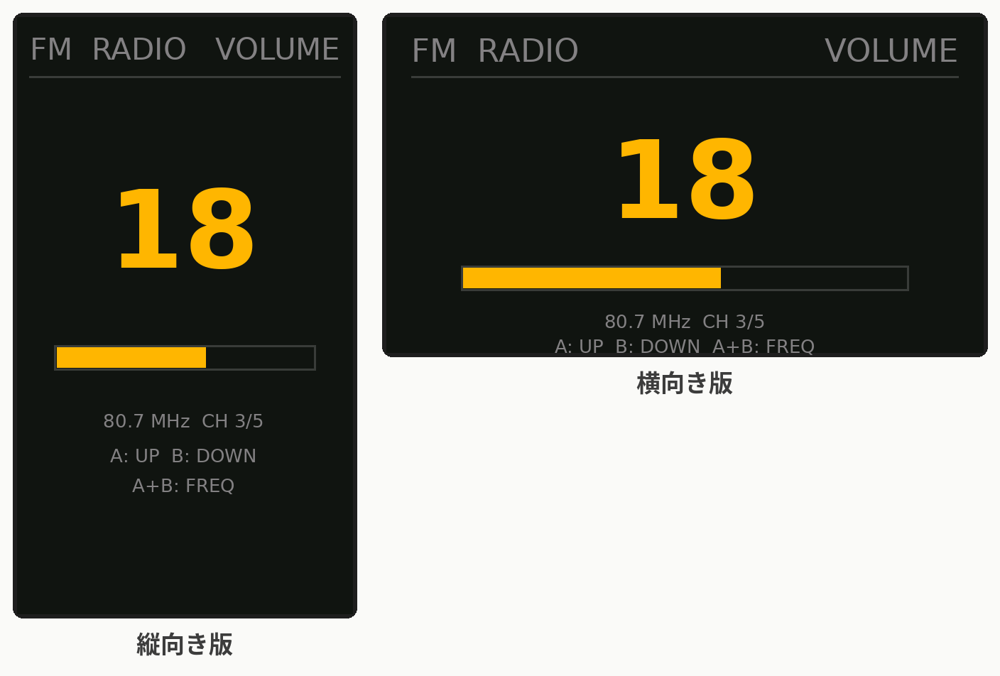
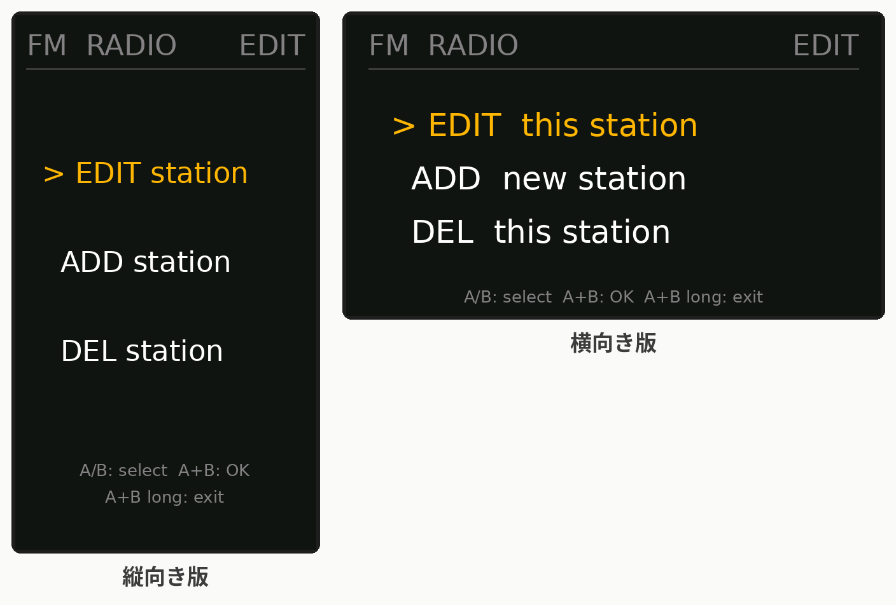
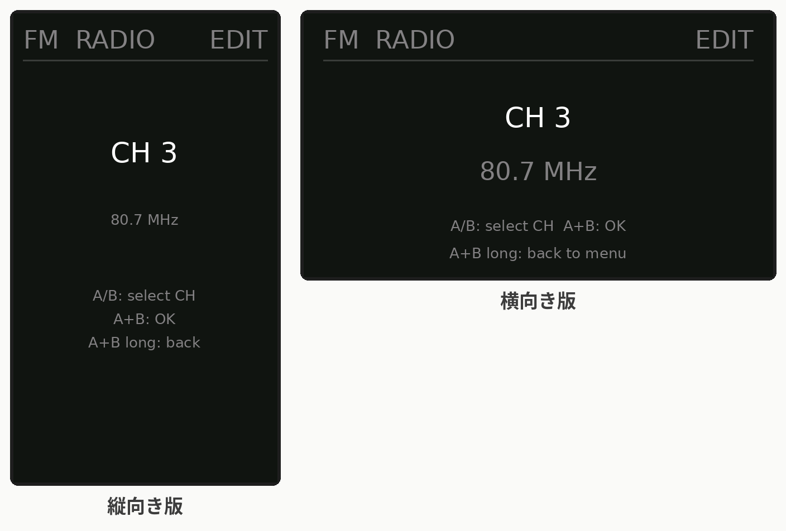
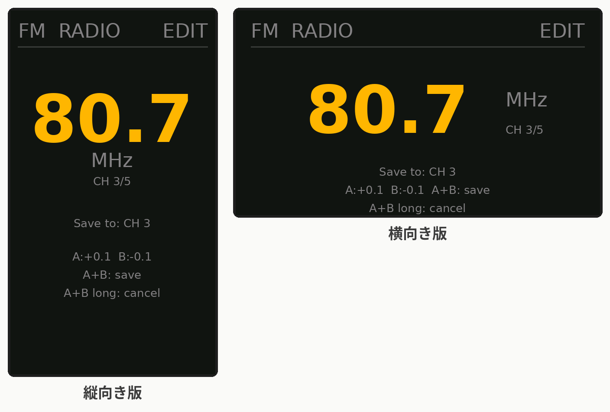
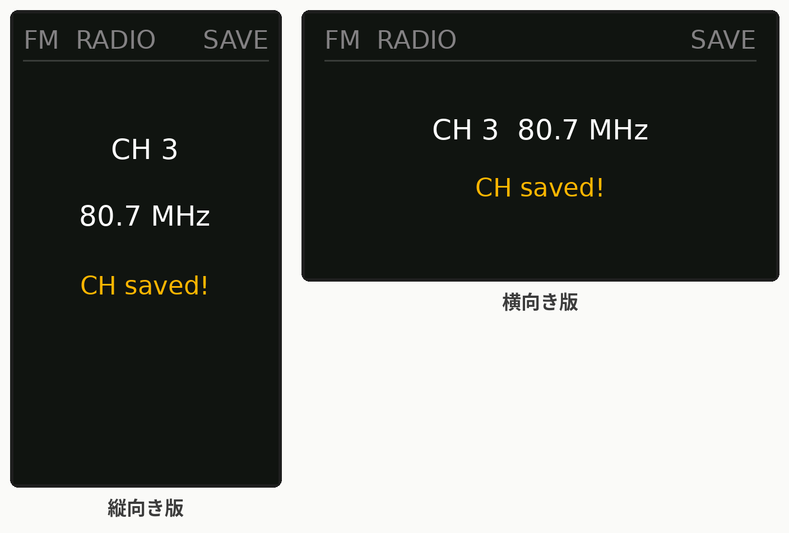
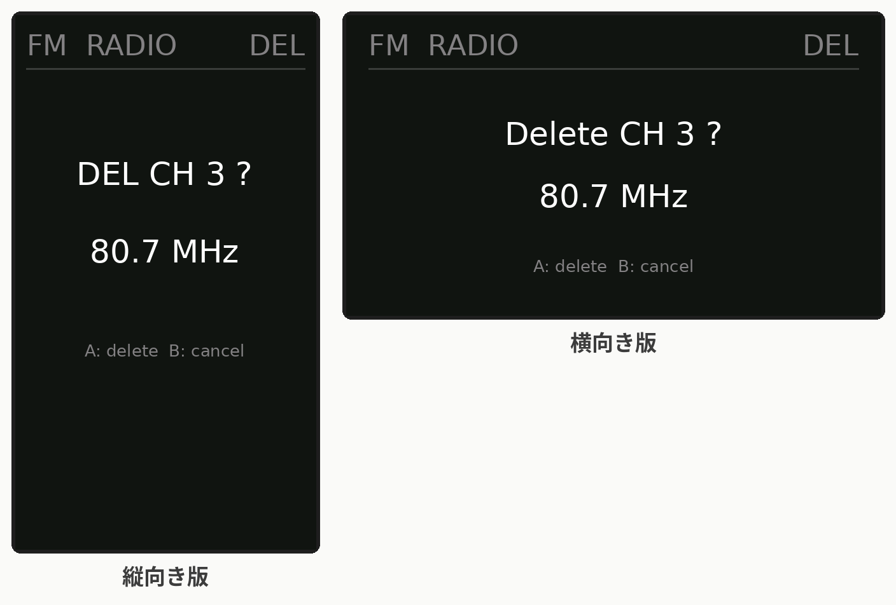

# DSP-FMRADIO-MODULE-KT0913
https://massa4649.booth.pm/items/5619730 の製品説明となります。　　

## 概要
モジュールを制御するマイコンとのインターフェース用の端子配列は、M5StickC-PLUSのコネクタに直刺しで動作させることを考慮した設計にしています。
また、FM受信アンテナは、Φ3.5mmステレオミニジャックに接続するイアホンやオーディオケーブルのGNDラインを利用する仕様となっています。

## 選局/周波数変更
モジュールの4番端子はKT0913のチップイネーブル端子の9番ピンに接続されています。I2C制御を開始する前にHighにすることが必要です。
受信チャンネルの選局方法については、I2C制御でKT0913の周波数に関するレジスタ設定値を変更することで周波数を上下に可変できます。  
TUNE [Address 0X03]
|FMCHAN<11:0>|Example|
|-----|-----|
|0110 1011 1000|0X06B8 = 1720*50kHz = 86MHz |

## 音量調節
音量の調節について、I2C制御でKT0913の音量に関するレジスタ設定値を変更することで可変できます。  
RXCFG [Address 0X0F]
|VOLUME<4:0>|Attenuation|
|-----|-----|
|11111|0dB (max)|
|11110|-2dB|
|11101|-4dB|
|11100|-6dB|
|・・・|・・・|
|00010|-58dB|
|00001|-60dB|
|00000|Mute|

## その他
・2024年9月現在においては、KT0913は電子部品ショップの秋月電子さんでも販売されていますので、そちらのWEBサイトにデータシートがありますのでご参照下さい。  
TOPページ：https://akizukidenshi.com/catalog/c/c0/  
販売コード：117873  
・モジュールに実装されている水晶振動子は、デフォルトのレジスタ設定で動作するように32.768kHzを使用しています。

## 外観
・8ピンヘッダを実装していてM5StickC PLUSの端子とスムーズに接続できます。


## 端子配列
|Pin|Pin Name|I/O|Function|
|-----|-----|-----|-----|
|1|GND|Ground|Ground|
|2|NC|-|Non Connection|
|3|SCL|Digital I/O|SCL of 2-wire interface|
|4|EN|Input|Chip enable. internal 600kΩ Pulldown (※connected to pin9 of KT0913)|
|5|SDA|Digital I/O|SDA of 2-wire interface|
|6|NC|-|Non Connection|
|7|+3.3V|Power|Power supply (※2.1～3.6V)|
|8|NC|-|Non Connection|

## 使用例

### M5stickC Plus でコントロール

可変周波数範囲はICのレジスタ設定で決定します。（ICの機能としては32MHz～110MHzの受信が可能）  
プログラミング次第ですが、周波数変更の手段としてM5stickC PlusのボタンAとボタンBを使用できます。  
サンプルプログラムではAボタンで100kHz周波数がアップします。  
あらかじめ受信可能なラジオ曲の周波数をプリセットとしてプログラムに配列で定義すれば、ボタンAを押すとプリセットされた次の局へ進み、ボタンBで前の局へ戻るようなプログラムの実装も可能です。
```
  if (M5.BtnA.wasPressed() && dial == 0 && AM_FM == "FM") {
    REGISTER_ADDRESS = TUNE;
    I2CreadMULTIbyte();
    data = (data + 0x0002) | 0B1000000000000000; // + 100KHz step   = 100/50  76MHz - 94.1MHz
    if ( (data & 0B0000111111111111)  > 1882){
      data = 0B1000010111110000; // 76MHz 1520 = 5F0
    }
  I2CsendMULTIbyte();
  }

  if (M5.BtnB.wasPressed() && dial == 0 && AM_FM == "FM") {
    REGISTER_ADDRESS = TUNE;
    I2CreadMULTIbyte();

    data = (data - 0x0002) | 0B1000000000000000; // - 100KHz step   = 100/50  76MHz - 94.1MHz
    if ( (data & 0B0000111111111111) <1520) {  //<76MHz
      data = 0B1000011101011010; // 94.1MHz  1882
    }
  I2CsendMULTIbyte();
  }
```
  
[](https://youtu.be/vZIJL4G87UQ)

### M5StickC Plus 用ラジオプログラムの操作説明（KT0913版）

M5StickC Plus に本モジュールを直刺しして使う、FM ラジオプログラムの操作説明です。
画面の向きが縦向き版と横向き版の 2 種類があり、操作はどちらも同じです（画面イメージは両方を並べて掲載しています）。


- 受信範囲は FM 76.0 ～ 110.0 MHz です。
- 選局はプリセット方式で、最大 10 局まで登録できます（初期状態では 78.9 / 80.0 / 80.7 / 81.3 / 82.5 MHz の 5 局が入っています）。
- プリセットは本体のボタン操作だけで変更・追加・削除ができ、電源を切っても保存されています。
- 音量もボタンで調節でき、最後に聞いていた局と音量は次回起動時に復元されます。

#### 起動のしかた

1. モジュールを M5StickC Plus に接続して電源を入れます。
2. タイトル画面「FM RADIO / KT0913 / 76 - 110 MHz」が表示されます（約 1.5 秒）。
3. 続いて操作説明の画面（スタート画面）が表示されます。この画面ではまだ音は出ません。
4. ボタン A または B を押すとラジオが始まります。前回聞いていた局と音量で再生されます（初めて使うときは CH 1 から始まります）。

#### 画面の見方（通常画面）



- 大きく受信周波数（MHz）と、プリセット番号「CH n/N」が表示されます。
- 上部に RSSI（受信レベル）、SNR、STEREO / MONO の状態が表示されます。
- 周波数の下に 76 ～ 110 MHz のチューニングスケールがあり、現在の位置に目印が付きます。
- 画面下部にプリセット一覧（1 ～ 10）が表示され、再生中の局はオレンジ色で表示されます。空きチャンネルは「--」です。

#### 基本操作（選局）

| 操作 | 動作 |
| --- | --- |
| ボタン A 短押し | 次のプリセット局へ進む |
| ボタン B 短押し | 前のプリセット局へ戻る |

#### 音量の調節

1. ボタン A と B を同時に短く押すと、音量モード（VOLUME）に入ります。
2. ボタン A で音量が上がり、ボタン B で下がります（0 ～ 31、1 回の操作で 2 ずつ変わります）。
3. もう一度 A と B を同時に短く押すと、通常画面に戻ります。何も操作しないと 5 秒で自動的に通常画面に戻ります。



#### プリセットの編集

通常画面（または音量モード）で、ボタン A と B を同時に 1.5 秒長押しすると、編集メニューに入ります。

メニューは次の 3 項目です。ボタン A / B で選んで、A と B の同時短押しで決定します。同時長押しでメニューを抜けて通常画面に戻ります。

| 項目 | 内容 |
| --- | --- |
| EDIT | 登録済みの局の周波数を変更する |
| ADD | 新しい局を追加する（最大 10 局まで） |
| DEL | 登録済みの局を削除する |

※ 画面では、横向き版は「EDIT this station」のように、縦向き版は「EDIT station」のように短く表示されます。



##### 対象チャンネルの選択

項目を選ぶと、対象の CH を選ぶ画面になります。

- ボタン A / B で CH を切り替えます。
- A と B の同時短押しで決定し、次の画面へ進みます。
- A と B の同時長押しでメニューに戻ります。
- ADD のときは、挿入する位置を選びます。末尾を選ぶと「add at end」と表示され、最後尾に追加されます。途中の CH を選ぶと、その位置に入り、後ろの局が 1 つずつ後ろへずれます。



##### 周波数の変更（EDIT / ADD）

- ボタン A で +0.1 MHz、ボタン B で -0.1 MHz 変わります（範囲は 76.0 ～ 110.0 MHz）。
- ボタンを押し続けると自動で変わり続けます。0.5 秒押し続けると 0.1 MHz ずつ連続で変わり始め、2 秒以上押し続けると 1.0 MHz ずつ速く変わります。
- 周波数を変えると、その場で選局されて音も変わるので、聞きながら合わせられます。
- A と B の同時短押しで保存します。「CH saved!」と表示され、通常画面に戻ってその局を再生します。
- A と B の同時長押しでキャンセルします。保存はされず、メニューに戻ります。





##### 局の削除（DEL）

1. 対象の CH を選ぶと「Delete CH n ?」と周波数が表示されます（縦向き版では「DEL CH n ?」と表示されます）。
2. ボタン A で削除、ボタン B でキャンセル（メニューに戻ります）。
3. 削除すると、後ろの局が 1 つずつ前に詰まります。「CH deleted」と表示され、通常画面に戻ります。



※ 登録が 1 局だけのときは削除できません。また、10 局登録済みのときは ADD できません。

#### エラー表示

起動時にモジュールの状態をチェックし、問題があるとエラー画面を表示して停止します。

| 表示 | 意味と対処 |
| --- | --- |
| NO MODULE / KT0913 not connected | モジュールが接続されていません。接続を確認して再起動してください |
| WRONG CHIP / Not a KT0913 | KT0913 以外のモジュール（KT0937 など）が接続されています。画面に ID が表示されます。KT0913 モジュールを使ってください |

#### 動作環境（参考）

- 本体：M5StickC Plus
- Arduino 環境：ESP32 ボードマネージャ 2.1.0 / M5Unified 0.2.7

## 関連ブログ
https://massa4649.com/kt0913_1/

以上です。
